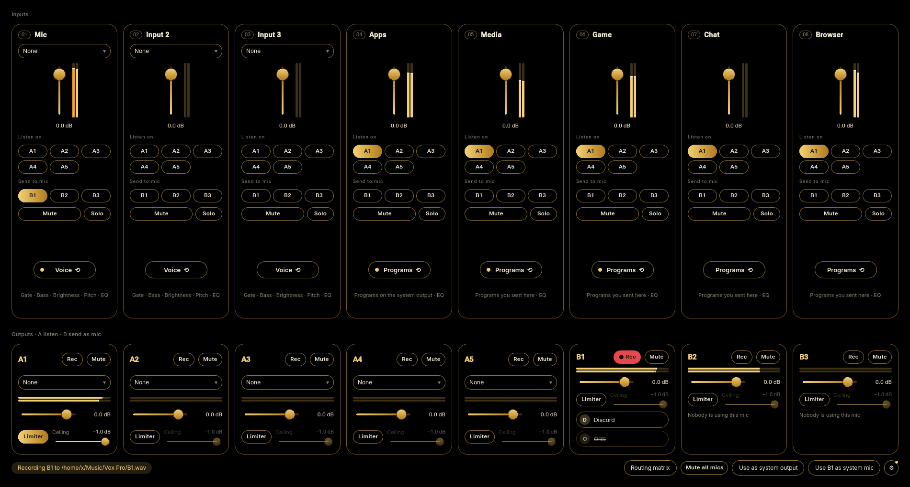
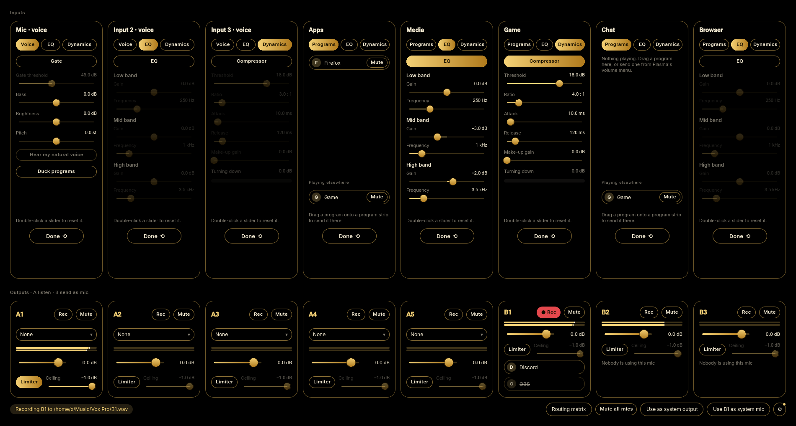
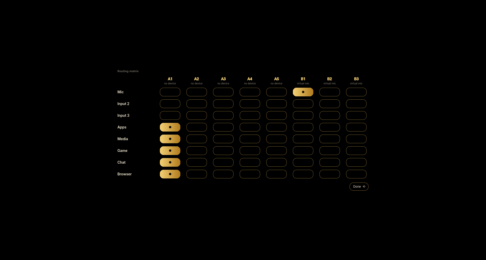
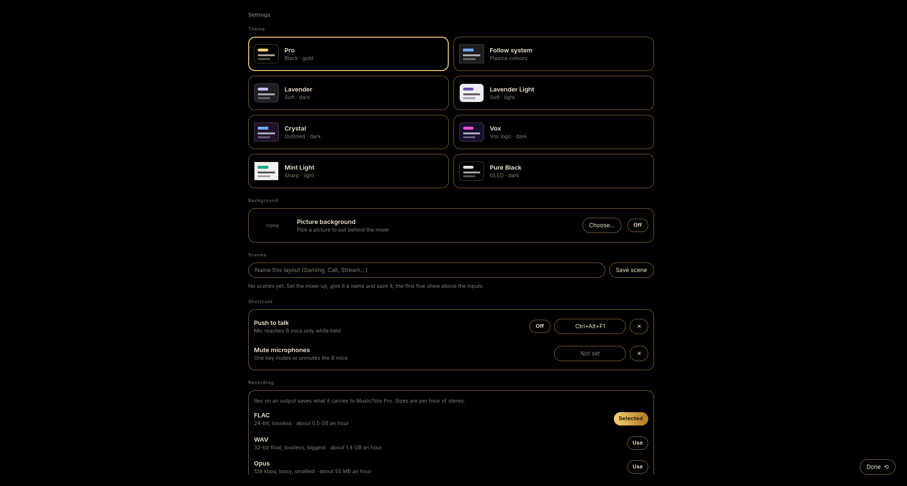

# Vox Pro

The bigger sibling of [Vox Obscurus](https://github.com/Obscuratea/vox-obscurus): a PipeWire audio
mixer and router for Linux with **8 inputs, 8 outputs** and the tools a streamer or podcaster
reaches for. Rust + PipeWire for the audio, Qt Quick for the interface. Not affiliated with VB-Audio.

## What's in it

- **8 strips:** three hardware inputs (mics, line-ins, anything PipeWire lists) and five virtual
  ones that programs play into: **Apps**, **Media**, **Game**, **Chat** and **Browser**. Each shows
  up as a *Vox Pro* output device, so you can send a program to its own strip.
- **8 outputs:** **A1–A5** play on hardware you pick (headphones, speakers, a soundbar), and
  **B1–B3** are virtual microphones for Discord, OBS and friends.
- **Routing matrix:** every strip to every output in one grid.
- **EQ and compressor on every strip**, mics and programs alike: a three-band EQ with adjustable
  frequencies and a soft-knee compressor with threshold, ratio, attack, release and make-up gain.
- **Voice tools on the mic strips:** noise gate, bass, brightness and pitch, plus auto-duck that
  dips Apps and Media while you talk.
- **A limiter on every output** with an adjustable ceiling, so nothing clips on the way out.
- **Recording:** hit **Rec** on any output to record exactly what it carries to
  `~/Music/Vox Pro/`. Pick **FLAC** (lossless, the default), **WAV** or **Opus** (small and lossy)
  in Settings.
- **Scenes, solo, per-program mute and drag-to-route**, push-to-talk and a mute-mics key (KDE global
  shortcuts), tray icon.
- **Themes:** the gold-on-black **PRO** look by default, plus Vox, Pure Black, Lavender, Crystal and
  more, or any picture as the window background.
- **Built-in updater** (Settings → About): one click downloads the newest release and installs it.
  Your settings are never touched.

Flip any strip to reach its tools:

(Screenshots use made-up programs and levels.)

## Install

Releases ship an Arch package. Download `vox-pro-*-x86_64.pkg.tar.zst` from the
[Releases page](https://github.com/Obscuratea/vox-pro/releases) and install it:

    sudo pacman -U vox-pro-*-x86_64.pkg.tar.zst

After that, updates come from inside the app.

## Build and run

Needs Rust, clang, cmake, Qt 6 (base and declarative), PipeWire development files and SoundTouch.

    cargo run --release

Settings are saved to `~/.config/vox-pro/settings.json` (with a `.bak` of the last good copy). Vox Pro
and Vox Obscurus keep separate settings and separate virtual devices, but you should only run one at
a time.

## Support development

Vox Pro is free to use. If it's useful to you and you'd like to help fund more work on it:

- Ko-fi: https://ko-fi.com/obscuratea
- Patreon: https://patreon.com/Obscuratea
- Discord: https://discord.gg/uqV26sCQFq

## Bugs and suggestions

Found a bug or have an idea? Please open an issue on the Issues page. I'm not taking code
contributions, but every report and suggestion is read.

## Licence

The licence terms are still being finalised; until then, all rights are reserved. See
[LICENSE](LICENSE). Credits and third-party licences (Qt and SoundTouch are LGPL, used as system
libraries) are in Settings → About and in [THIRD_PARTY.txt](THIRD_PARTY.txt).

## Layout

- `src/engine.rs`: PipeWire streams, virtual devices, mixing, routing and limiters
- `src/dsp.rs`: gate, shelves, EQ, compressor and the pitch stage
- `src/recorder.rs`: WAV, FLAC and Opus writers
- `src/updater.rs`: the in-app updater
- `src/settings.rs`: the saved layout and scenes
- `src/bridge.rs`: the `Mixer` object QML talks to
- `qml/`: the interface
