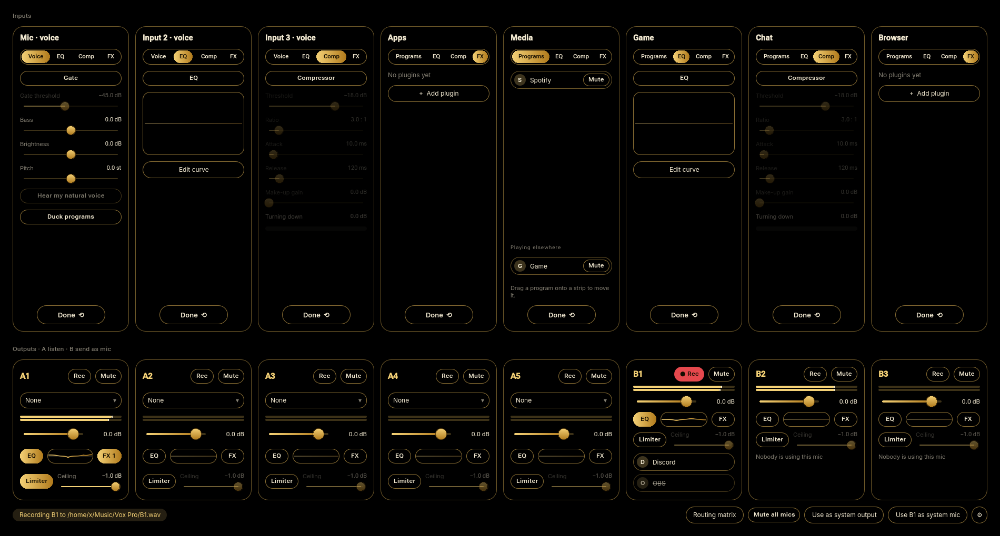
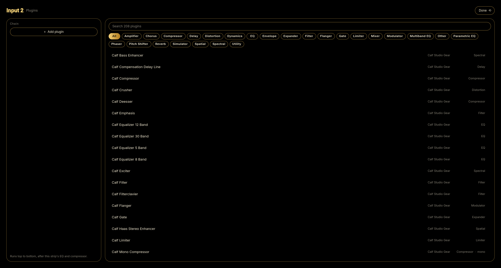
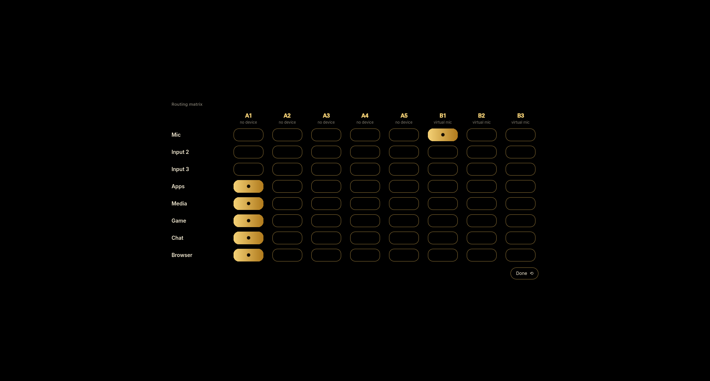
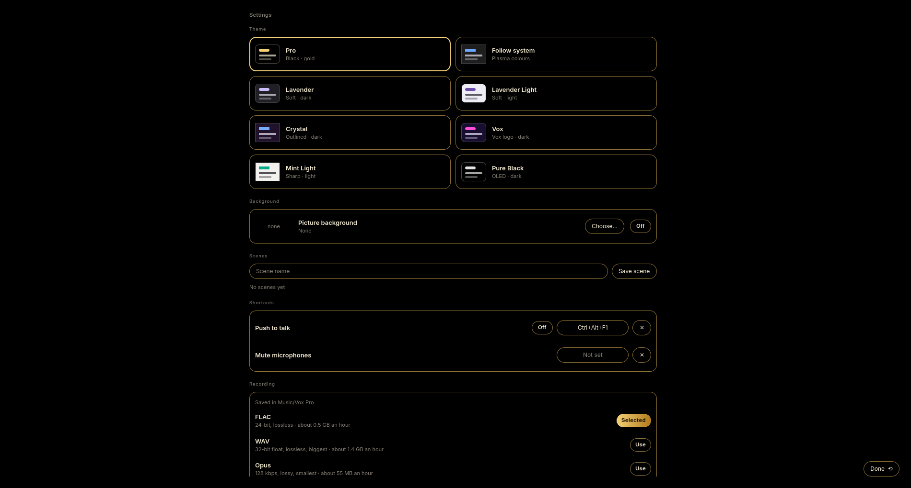

# Vox Pro

The bigger sibling of [Vox Obscurus](https://github.com/Obscuratea/vox-obscurus): a PipeWire audio
mixer and router for Linux with **8 inputs, 8 outputs** and the tools a streamer or podcaster
reaches for. Rust + PipeWire for the audio, Qt Quick for the interface. Not affiliated with VB-Audio.

## What's in it

- **8 strips:** three hardware inputs (mics, line-ins, anything PipeWire lists) and five virtual
  ones that programs play into: **Apps**, **Media**, **Game**, **Chat** and **Browser**. Each shows
  up as a *Vox Pro* output device, so you can send a program to its own strip.
- **8 outputs:** **A1–A5** play on hardware you pick (headphones, speakers, a soundbar), and
  **B1–B3** are virtual microphones for Discord, OBS and friends.
- **Routing matrix:** every strip to every output in one grid.
- **Parametric EQ on every strip and every output:** six cells each (bell, low and high shelf, low and
  high pass, notch) with frequency, gain and width. Drag the dots on the curve or set exact values.
- **Compressor on every strip**, mics and programs alike: soft knee, with threshold, ratio, attack,
  release and make-up gain.
- **Plugin rack:** load LV2, CLAP and VST3 plugins (LSP, Calf, x42, Dragonfly and anything else you have installed) on any strip
  or output, up to six in a chain, with a control for every plugin parameter.
- **Voice tools on the mic strips:** noise gate, bass, brightness and pitch, plus auto-duck that
  dips Apps and Media while you talk.
- **A limiter on every output** with an adjustable ceiling, so nothing clips on the way out.
- **Recording:** hit **Rec** on any output to record exactly what it carries to
  `~/Music/Vox Pro/`. Pick **FLAC** (lossless, the default), **WAV** or **Opus** (small and lossy)
  in Settings.
- **Scenes, solo, per-program mute and drag-to-route**, push-to-talk and a mute-mics key (KDE global
  shortcuts), tray icon.
- **Themes:** the gold-on-black **PRO** look by default, plus Vox, Pure Black, Lavender, Crystal and
  more, or any picture as the window background.
- **Built-in updater** (Settings → About): one click downloads the newest release and installs it.
  Your settings are never touched.

Flip any strip to reach its tools:

The parametric EQ, here on an output:

The plugin rack, with a plugin's controls and the list of installed plugins:

| Controls | Installed plugins |
| --- | --- |
|  |  |

(Screenshots use made-up programs and levels.)

### Plugins

Vox Pro hosts **LV2**, **CLAP** and **VST3** plugins that take mono or stereo audio in and out. It finds
the ones installed on your system (`/usr/lib/lv2`, `/usr/lib/clap`, `/usr/lib/vst3` and the same under
`~/.lv2`, `~/.clap`, `~/.vst3`); it doesn't ship any. On Arch, `lsp-plugins` (LV2, CLAP and VST3 builds),
`calf`, `x42-plugins` and `dragonfly-reverb` are a good start.

**Adding a plugin:** install it from your package manager and press **Rescan** in the plugin browser,
or just drop a `.clap`, a `.vst3` folder or a `.lv2` folder onto the rack window and Vox copies it into
your own plugin folder. It has to be a Linux build: Windows `.dll` plugins don't work.

Plugins get a generic control panel drawn by Vox, not their own windows. Instruments and plugins that
need MIDI, or more than two channels, aren't listed. A plugin runs inside Vox, so a faulty one can take
Vox down: if that happens while a plugin is loading or being scanned, the next start leaves it out
(or comes up with plugins switched off) and tells you.

## Install

Releases ship an Arch package. Download `vox-pro-*-x86_64.pkg.tar.zst` from the
[Releases page](https://github.com/Obscuratea/vox-pro/releases) and install it:

    sudo pacman -U vox-pro-*-x86_64.pkg.tar.zst

After that, updates come from inside the app.

## Build and run

Needs Rust, clang, cmake, Qt 6 (base and declarative), PipeWire development files, SoundTouch and lilv.

    cargo run --release

Settings are saved to `~/.config/vox-pro/settings.json` (with a `.bak` of the last good copy). Vox Pro
and Vox Obscurus keep separate settings and separate virtual devices, but you should only run one at
a time.

## Support development

Vox Pro is free to use. If it's useful to you and you'd like to help fund more work on it:

- Ko-fi: https://ko-fi.com/obscuratea
- Patreon: https://patreon.com/Obscuratea
- Discord: https://discord.gg/uqV26sCQFq

## Bugs and suggestions

Found a bug or have an idea? Please open an issue on the Issues page. I'm not taking code
contributions, but every report and suggestion is read.

## Licence

Free to download and use, including commercially (a streamer or podcaster using it for audio routing
is exactly what it's for). Not open source: you can't modify it, redistribute it, publish forks or
derived versions, or sell it. See [LICENSE](LICENSE). Credits and third-party licences (Qt and
SoundTouch are LGPL, used as system libraries) are in Settings → About and in
[THIRD_PARTY.txt](THIRD_PARTY.txt).

## Layout

- `src/engine.rs`: PipeWire streams, virtual devices, mixing, routing and limiters
- `src/dsp.rs`: gate, shelves, compressor and the pitch stage
- `src/peq.rs`: the parametric EQ
- `src/plugins.rs`: the plugin host (LV2), `src/plug_clap.rs` and `src/plug_vst3.rs`: the CLAP and VST3 sides
- `src/recorder.rs`: WAV, FLAC and Opus writers
- `src/updater.rs`: the in-app updater
- `src/settings.rs`: the saved layout and scenes
- `src/bridge.rs`: the `Mixer` object QML talks to
- `qml/`: the interface
