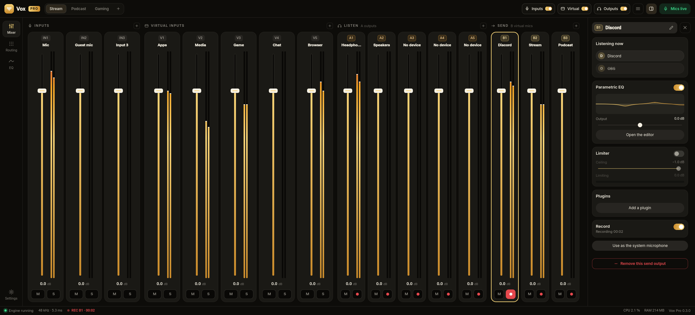
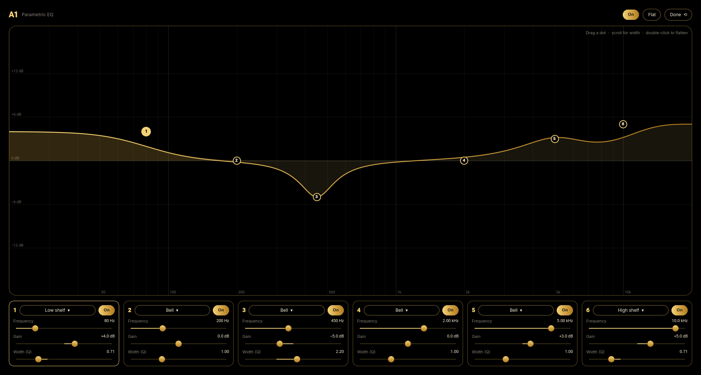

# Vox Pro

The bigger sibling of [Vox Obscurus](https://github.com/Obscuratea/vox-obscurus): a PipeWire audio
mixer and router for Linux with more channels and a **plugin rack**, for streamers and podcasters.
Rust + PipeWire for the audio, Qt Quick for the interface. Not affiliated with VB-Audio.

## What's in it

Everything in Vox Obscurus, plus:

- **More channels:** up to 6 hardware inputs, 8 virtual inputs (Apps, Media, Game, Chat, Browser,
  Music, Stream, Aux), 6 A outputs and 4 B virtual mics. It starts with 3 hardware inputs, 5 virtual
  inputs, A1–A5 and B1–B3; add or remove channels with the **+** in each section header or in
  Settings → Layout.
- **Plugin rack:** LV2, CLAP and VST3 plugins (LSP, Calf, x42, Dragonfly and anything else you have
  installed) on any input or output, up to six in a chain, with a control for every plugin parameter.
  The **FX** switch on a strip bypasses its whole chain.

And, as in Vox Obscurus:

- **Parametric EQ, compressor and voice tools** on the inputs (noise gate, bass, brightness, pitch,
  auto-duck), **parametric EQ and a limiter** on every output.
- **Mono** and **Dim** (−20 dB) on each A output.
- **Recording:** the red dot on an output records exactly what it carries, as FLAC, WAV or Opus, to
  `~/Music/Vox Pro` or a folder you pick.
- **Routing page**, scenes in the top bar, solo, per-program mute and drag-to-route, names for every
  channel, tray icon, global shortcuts (push to talk, mute all mics, next scene, show or hide), start with
  the computer, mute mics when the screen locks, sample rate and latency.
- **Themes:** **Gold** by default, plus Night, Glass and Light, or any picture as the window background.
- **Built-in updater** (Settings → About): one click downloads the newest release and installs it.
  Your settings are never touched.

Click a strip to open its inspector: device, voice tools, EQ, compressor or limiter, plugins and
recording.

| An input | An output, recording |
| --- | --- |
|  |  |

| Parametric EQ (on any input or output) | Routing |
| --- | --- |
|  |  |

The plugin rack:

(Screenshots use made-up programs and levels.)

### Plugins

Vox Pro hosts **LV2**, **CLAP** and **VST3** plugins that take mono or stereo audio in and out. It finds
the ones installed on your system (`/usr/lib/lv2`, `/usr/lib/clap`, `/usr/lib/vst3` and the same under
`~/.lv2`, `~/.clap`, `~/.vst3`); it doesn't ship any. On Arch, `lsp-plugins` (LV2, CLAP and VST3 builds),
`calf`, `x42-plugins` and `dragonfly-reverb` are a good start.

**Adding a plugin:** install it from your package manager and press **Rescan** in the plugin browser,
or just drop a `.clap`, a `.vst3` folder or a `.lv2` folder onto the rack window and Vox copies it into
your own plugin folder. It has to be a Linux build: Windows `.dll` plugins don't work.

Plugins get a generic control panel drawn by Vox, not their own windows. Instruments and plugins that
need MIDI, or more than two channels, aren't listed. A plugin runs inside Vox, so a faulty one can take
Vox down: if that happens while a plugin is loading or being scanned, the next start leaves it out
(or comes up with plugins switched off) and tells you.

## Install

Releases ship an Arch package. Download `vox-pro-*-x86_64.pkg.tar.zst` from the
[Releases page](https://github.com/Obscuratea/vox-pro/releases) and install it:

    sudo pacman -U vox-pro-*-x86_64.pkg.tar.zst

After that, updates come from inside the app.

## Build and run

Needs Rust, clang, cmake, Qt 6 (base, declarative, and Widgets for the tray icon), KWindowSystem,
PipeWire development files, SoundTouch and lilv.

    cargo run --release

Settings are saved to `~/.config/vox-pro/settings.json` (with a `.bak` of the last good copy). Vox Pro
and Vox Obscurus keep separate settings and separate virtual devices, but you should only run one at
a time.

## Support development

Vox Pro is free to use. If it's useful to you and you'd like to help fund more work on it:

- Ko-fi: https://ko-fi.com/obscuratea
- Patreon: https://patreon.com/Obscuratea
- Discord: https://discord.gg/uqV26sCQFq

## Bugs and suggestions

Found a bug or have an idea? Please open an issue on the Issues page. I'm not taking code
contributions, but every report and suggestion is read.

## Licence

Free to download and use, including commercially (a streamer or podcaster using it for audio routing
is exactly what it's for). Not open source: you can't modify it, redistribute it, publish forks or
derived versions, or sell it. See [LICENSE](LICENSE). Credits and third-party licences (Qt and
SoundTouch are LGPL, used as system libraries) are in Settings → About and in
[THIRD_PARTY.txt](THIRD_PARTY.txt).

## Layout

- `src/engine.rs`: PipeWire streams, virtual devices, mixing, routing and limiters
- `src/dsp.rs`: gate, shelves, compressor and the pitch stage
- `src/peq.rs`: the parametric EQ
- `src/plugins.rs`: the plugin host (LV2), `src/plug_clap.rs` and `src/plug_vst3.rs`: the CLAP and VST3 sides
- `src/recorder.rs`: WAV, FLAC and Opus writers
- `src/updater.rs`: the in-app updater
- `src/settings.rs`: the saved layout, scenes and preferences
- `src/shortcuts.rs`: global shortcuts through KDE's KGlobalAccel
- `src/desktop.rs`: start with the computer, and the screen-lock watch
- `src/bridge.rs`: the `Mixer` object QML talks to
- `qml/`: the interface. Every file except `qml/Main.qml`, `qml/PluginRack.qml` and the shared Rust
  files above are the same in Vox Obscurus.
