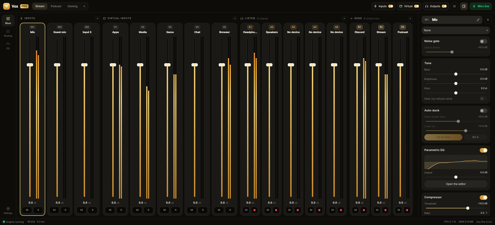
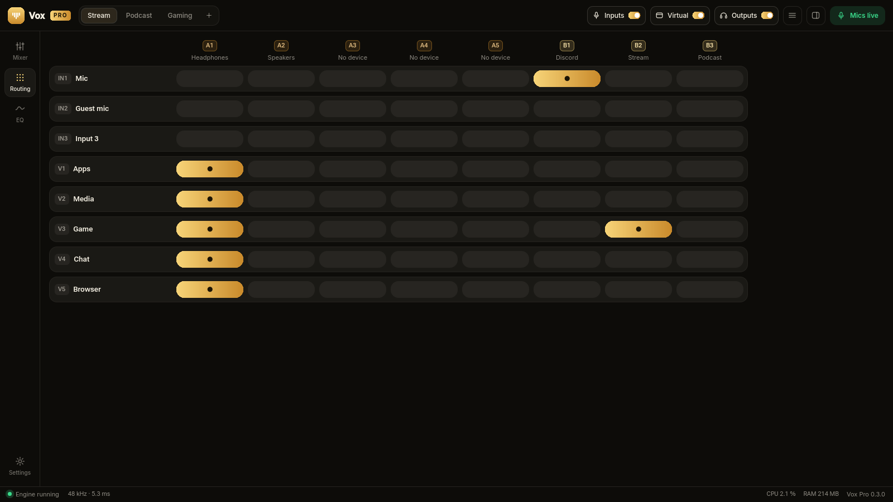

# Vox Pro

Audio mixer and router for Linux (PipeWire) with a plugin rack. Rust + Qt Quick. Not affiliated with
VB-Audio. The smaller version is [Vox Obscurus](https://github.com/Obscuratea/vox-obscurus).

Made by [Obscuratea](https://github.com/Obscuratea), who designs Vox Pro, decides what it does and how it
looks, tests every release and publishes it. The code is written with Claude Code (an AI coding tool);
[TESTING.md](TESTING.md) says how it is tested.

| Input inspector | Output inspector, recording |
| --- | --- |
|  |  |

| Parametric EQ | Routing |
| --- | --- |
|  |  |

## Features

Everything in Vox Obscurus, plus:

- Up to 6 hardware inputs, 8 virtual inputs, 6 A outputs and 4 B virtual mics.
- Plugin rack: LV2, CLAP and VST3, up to six per channel, FX switch to bypass the chain.

Shared with Vox Obscurus:

- Noise gate, bass, brightness, pitch and auto-duck on hardware inputs.
- Parametric EQ on every channel, compressor on every input, limiter on every output.
- Mono and Dim (−20 dB) on A outputs.
- Recording any output to FLAC, WAV or Opus.
- Routing page, solo, per-program mute, drag-to-route, scenes, custom channel names.
- Tray icon, global shortcuts (KDE Plasma), start with the computer, mute mics on screen lock.
- Sample rate and latency settings.
- Themes: Gold, Night, Glass, Light, or a picture background.
- Built-in updater (Settings → About).

## Plugins

Plugins are found in `/usr/lib/{lv2,clap,vst3}` and `~/.{lv2,clap,vst3}`. None are bundled. On Arch:
`lsp-plugins`, `calf`, `x42-plugins`, `dragonfly-reverb`.

- Add: install from your package manager and press **Rescan**, or drop a `.clap`, `.vst3` or `.lv2`
  onto the rack. Linux builds only.
- Controls are drawn by Vox; plugin windows are not shown.
- Instruments, MIDI plugins and plugins with more than two channels are not listed.
- If a plugin crashes Vox, the next start leaves it out.

## Requirements

A Linux system that uses **PipeWire** (0.3.77 or newer) with WirePlumber for its sound. Most current
distributions do: Fedora, Bazzite, SteamOS, Arch and CachyOS, Ubuntu 24.04 and newer, Linux Mint 22 and
newer, Debian 13. Systems that still use PulseAudio (for example Ubuntu 22.04 or Linux Mint 21) are not
supported. To check, run `pactl info | grep "Server Name"`: it should mention PipeWire.

## Install

Download `vox-pro-*-x86_64.pkg.tar.zst` from the
[Releases page](https://github.com/Obscuratea/vox-pro/releases):

    sudo pacman -U vox-pro-*-x86_64.pkg.tar.zst

## Build

Needs Rust, clang, cmake, Qt 6 (base, declarative, widgets), KWindowSystem, PipeWire, SoundTouch and lilv.

    cargo run --release

Settings: `~/.config/vox-pro/settings.json` (plus a `.bak`). Run Vox Pro or Vox Obscurus, not both.

## Support

- Ko-fi: https://ko-fi.com/obscuratea
- Patreon: https://patreon.com/Obscuratea
- Discord: https://discord.gg/uqV26sCQFq

Bugs and ideas go on the Issues page. Code contributions are not accepted.

## Licence

Free to use, including commercially. Not open source: no modifying, redistributing, forks or resale.
See [LICENSE](LICENSE). Third-party licences: [THIRD_PARTY.txt](THIRD_PARTY.txt).
